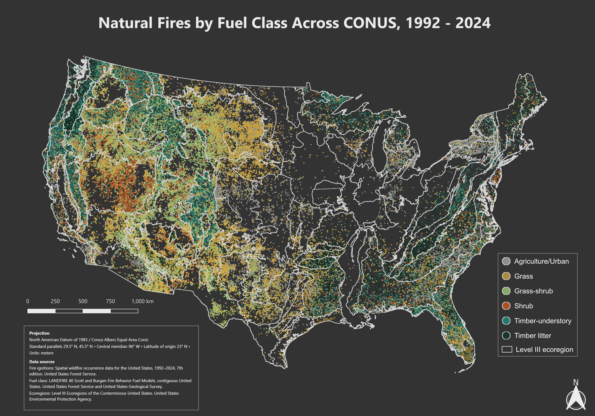
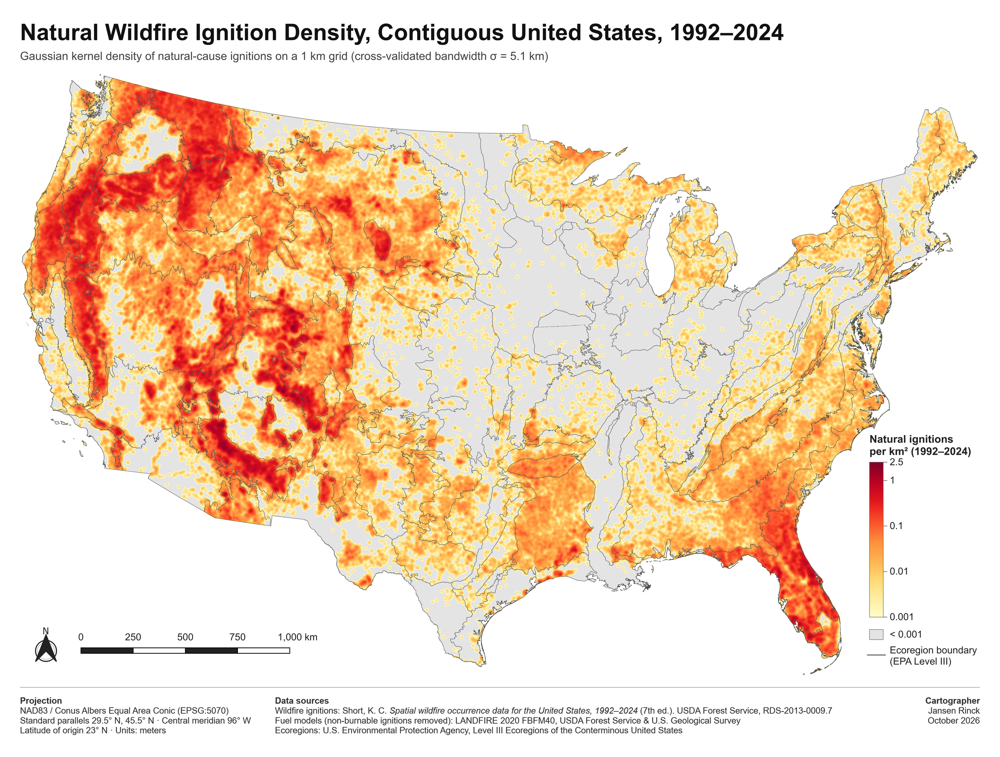

# Natural Ignitions by Fuel Type

Where do natural wildfire ignitions concentrate across the contiguous United States, which fuel types are most prone to them for the area they cover, and how much of the difference between ecoregions comes from the mix of fuels on the ground? This project answers those questions with 33 years of fire records (1992 to 2024), a national fuel model raster, and the 85 Level III ecoregions.

Course project for Computer Science 502, Geospatial Data Science, University of Montana, October 2026. Authors: Jansen Rinck, Benjamin Barlog, and Jianru Shen.



## Question and hypothesis

Between 1992 and 2024, how are natural wildfire ignitions distributed across fuel types, which fuel types are most susceptible to natural ignitions relative to the area they cover, and how does each ecoregion's mix of fuels explain differences in ignition density between ecoregions?

Hypothesis: ignitions are concentrated in specific fuel types, timber-understory fuels are the most susceptible for the area they cover, and differences between ecoregions are driven mainly by their fuel mix. The full findings are in the final report in pdfs/.

## Data

| Dataset | Source | Use |
|---|---|---|
| Spatial wildfire occurrence data for the United States, 1992 to 2024 (7th edition) | United States Forest Service | Ignition points, cause, discovery date, size |
| LANDFIRE 40 Scott and Burgan fire behavior fuel models, 30 m raster | United States Forest Service and Geological Survey | Fuel type at each ignition and fuel area per ecoregion |
| Level III ecoregions of the conterminous United States | Environmental Protection Agency | The 85 regions used for comparison |
| Geostationary Lightning Mapper hourly thunder hour product | NASA | Planned follow-up analysis, not used in the main results |

The data is too large for the repository (about 6.9 GB). data/README.md lists every download link and explains how to rebuild each processed file.

## Method

Fires with a natural cause were tagged with the fuel class under each point and with the ecoregion that contains it. Urban, snow and ice, open water, barren, slash-blowdown, and no-data fuel classes were removed, which leaves 319,148 natural ignitions. Fuel area per ecoregion was counted from the 30 m raster in windows, so the full raster never has to fit in memory.

The analysis has three iterations. First, a kernel density estimate of ignitions on a 1 km grid, with the 5.1 km bandwidth chosen by grid search and 5-fold cross-validation. Second, ignitions per 1,000 km² of fuel for each ecoregion, which removes the effect of ecoregion size and unburnable land. Third, spatial autocorrelation with Queen contiguity weights and Moran's I, to test whether high-ignition ecoregions cluster next to each other.

All maps use the NAD83 Conus Albers Equal Area projection (EPSG:5070).

## Selected results



About half of all natural ignitions fall within 5.1 percent of the contiguous United States, and 80 percent fall within 15.8 percent. The highest ignition density is in the Arizona/New Mexico Mountains, at nearly 0.3 ignitions per km². After normalizing by fuel area, the median ecoregion has about 11 natural ignitions per 1,000 km² and the highest has about 316. Only 20 ecoregions exceed 50, and 16 of those exceed 100. Florida stays a hotspot after normalizing, even though it is a wet region.

## Repository layout

| Folder | Contents |
|---|---|
| notebooks/ | Analysis as Jupytext Python files (the .py is tracked, notebooks are regenerated from it) |
| QGIS/ | QGIS project for the final maps |
| outputs/ | Interactive ecoregion by fuel dashboard (HTML) |
| pdfs/ | Data design, project launch, and final reports |
| images/ | Overview figures |
| docs/ | Workflow diagram |
| literature/ | Reference papers |
| data/ | Not tracked. Rebuild with data/README.md |
| .devcontainer/ and gds-base/ | Container definitions |

## Run it

The analysis runs in a container built on the darribas/gds image. Build the base image, then the project image:

```
docker build -t gds-base:latest ./gds-base
docker build -t gds-project2 .devcontainer
```

The project image adds NASA Earthdata access (earthaccess). Earthdata downloads need a free account, and the container reads your credentials at start-up, so none are stored in this repository. QGIS is left out of the base image on purpose, because this project uses rasterio and geopandas and never calls PyQGIS.

Then follow data/README.md: download the four source datasets, run notebooks/Project2.py to build the processed files, and open QGIS/Project2.qgz.

## Tools

Python, GeoPandas, rasterio, scikit-learn, libpysal, Bokeh, matplotlib, QGIS, Docker.
